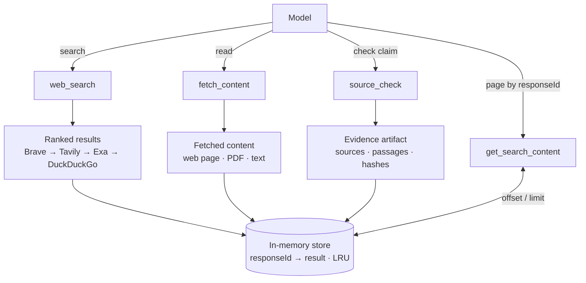
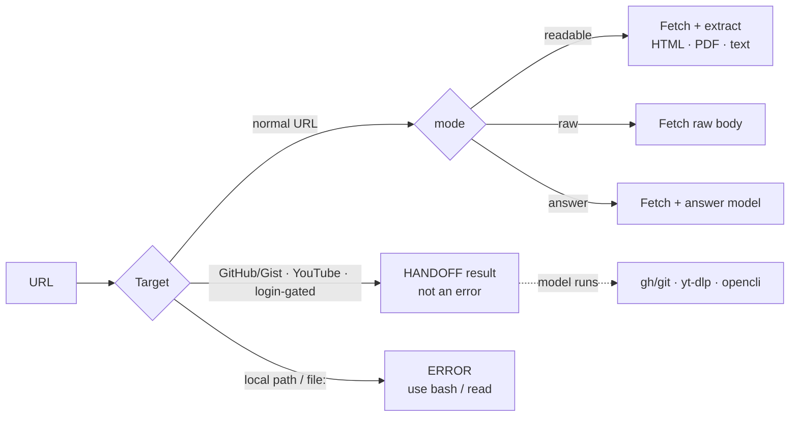

# Architecture

`pi-web` is one Pi extension. `index.ts` declares the tool surface with typebox schemas; `src/core.ts` holds the tool bodies; everything else is a small module with one job.

## Tool surface

## Module layout

| Path | Responsibility |
|---|---|
| `index.ts` | Extension entry: typebox schemas, tool registration, config load at startup. |
| `src/core.ts` | Tool bodies, inline truncation, `mode: "answer"` model call. |
| `src/config.ts` | `web.json` load and validation, credential template resolution. |
| `src/search.ts` | Provider chain, per-provider rate-limit cooldown. |
| `src/fetch.ts` | Target classification, handoff dispatch, per-URL pipeline. |
| `src/http.ts` | HTTP fetch, readability/turndown extraction, Jina fallback, PDF branch. |
| `src/ssrf.ts` | URL validation, manual redirect loop, private/reserved address blocking. |
| `src/source-check.ts` | Source classification, passage extraction, content hashing. |
| `src/storage.ts` | In-memory LRU store keyed by `responseId`. |
| `src/handoff.ts` | Host table and handoff messages. |
| `src/pdf.ts`, `src/types.ts`, `src/utils.ts` | PDF text extraction, shared types, errors/timeouts/dedupe helpers. |

## `fetch_content` routing

Each URL is classified before anything is fetched, in `src/fetch.ts`:

- Local paths, `file:` URLs, and URLs with embedded credentials are rejected outright.
- Handoff hosts are matched by a hardcoded table in `src/handoff.ts`. Order matters:
  GitHub, Gist, and YouTube are checked before the OpenCLI rules, and the OpenCLI
  rules run before any network fetch, so a login-gated site never gets a plain HTTP
  attempt.
- A handoff is a normal result, stored under the fetch's `responseId`. Real fetch
  failures return `ERROR: <url>`.
- `isError` is true only when every URL in the batch failed and none was a handoff.
- Up to three URLs per call, fetched with bounded concurrency (`mapLimit`).

## Fetch limits (`src/http.ts`)

- 30 s timeout per request, 5 MiB text cap, 20 MiB PDF cap.
- `readable` mode: Markdown negotiated first; on 403/429/5xx it retries through
  `r.jina.ai`; otherwise HTML is extracted locally (readability + turndown).
- `raw` mode: body verbatim, no extraction.
- `mode: "answer"` keeps the fetched text stored and replaces the inline text with the
  answer model's response; if nothing was readable it says so instead of calling the
  model.

## Provider fallback (`src/search.ts`)

- The chain is the `providers` array from config, in order. `provider: "<name>"` pins
  one provider and disables the chain.
- Only a `RATE_LIMIT` error advances to the next provider. That provider enters a
  process-lifetime cooldown (`coolingDown`) and is skipped by `auto` and rejected when
  named. Any other error ends the search for that query with an error result.
- `abort` propagates immediately and never falls through.
- Queries run concurrently, at most three at a time; duplicates are collapsed.

## Storage and inline budget (`src/storage.ts`, `src/core.ts`)

- A `Map` where insertion order is LRU order: every read moves the entry to the end.
- Bounded at 128 entries and 128 MiB total; exceeding either evicts from the front.
- IDs are `Date.now().toString(36)` plus random base36 — short, not security-sensitive.
- Inline output is capped at 30 000 bytes. Truncation appends a `get_search_content`
  hint with the exact `offset` to continue from, so paging is mechanical.
- Nothing is persisted: the store dies with the Pi process.

## Security (`src/ssrf.ts`)

- `validateRemoteUrl` accepts only `http:`/`https:`, rejects embedded credentials, and
  resolves DNS before connecting.
- Blocked: loopback, private (10/8, 172.16/12, 192.168/16), CGNAT, link-local, 0/8,
  multicast and above, plus IPv6 ULA, link-local, multicast, `::`, `::1`, and
  IPv4-mapped/compatible/NAT64 forms.
- Redirects are followed manually (`redirect: "manual"`) so every hop is revalidated;
  five hops maximum. 303, and 301/302 on POST, downgrade to GET without a body.

## Configuration resolution (`src/config.ts`)

- `web.json` is validated structurally at load: unknown keys, unknown providers,
  duplicate providers, and missing per-provider key fields are all errors.
- Credentials stay unresolved until first use. `$VAR`/`${VAR}` read the environment
  (`$$` and `$!` escape), `!cmd` runs a command with a 10 s timeout and caches the
  result for the process.
- `answerModel` is passed to Pi's model registry, so Pi's own authentication applies.
