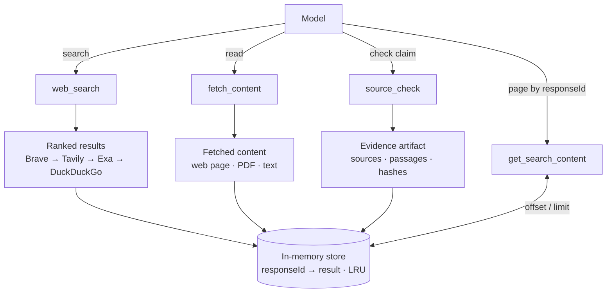
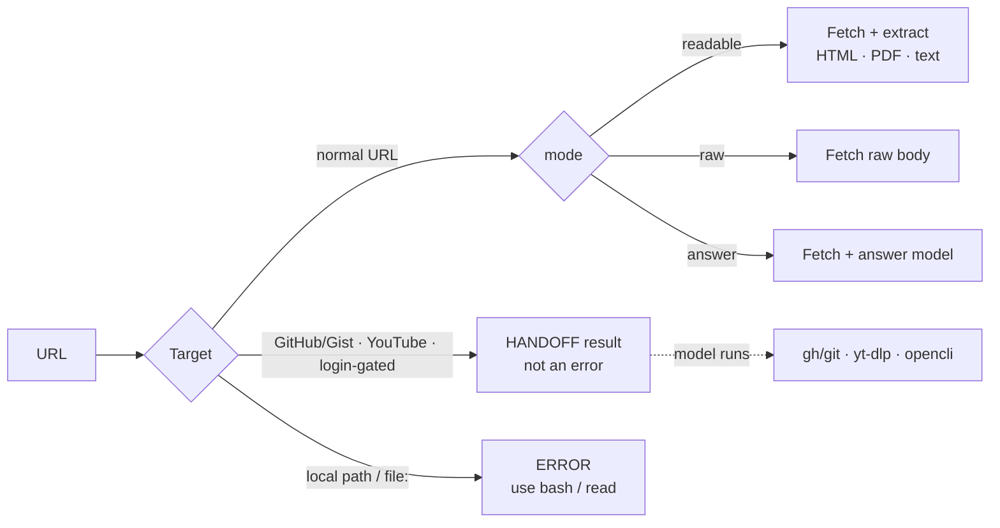

# pi-web

> Heavily inspired by the popular [pi-web-access](https://github.com/nicobailon/pi-web-access)

Minimal web access for Pi: search, fetch pages, page stored content, and check claims. If web is not the best way to get some data, it hands off to specialized CLI tools.

*How many tokens pi-web add to context?* **~1k**

## Install

```bash
pi install git:github.com/S1M0N38/pi-web
```

Then create `$PI_CODING_AGENT_DIR/web.json` (default: `~/.pi/agent/web.json`):

```json
{
  "providers": ["brave", "tavily", "exa", "duckduckgo"],
  "braveApiKey": "brv-...",
  "tavilyApiKey": "$TAVILY_API_KEY",
  "exaApiKey": "!security find-generic-password -s exa -w",
  "answerModel": "provider/model:reasoning-lvl"
}
```

```bash
chmod 600 "${PI_CODING_AGENT_DIR:-$HOME/.pi/agent}/web.json"
```

- `providers` is ordered fallback. Only rate limits fall through to the next provider.
- API keys can be literal strings, `$ENV_VAR` or `!cmd`. Only keys for listed providers are required.
- `answerModel` is a Pi model reference and uses Pi's existing model authentication.
- Brave, Tavily, Exa offer free usage/credits. DuckDuckGo needs no API key.
- Missing or invalid config fails at extension load.

## Remove

```bash
pi remove git:github.com/S1M0N38/pi-web
```

```bash
rm "${PI_CODING_AGENT_DIR:-$HOME/.pi/agent}/web.json"
```

## Optional CLIs

These CLIs are optional but strongly recommended. These are only needed when a handoff targets them:

- [`gh`](https://github.com/cli/cli) and [`git`](https://github.com/git/git) — GitHub repositories and Gists
- [`yt-dlp`](https://github.com/yt-dlp/yt-dlp) — YouTube
- [`opencli`](https://github.com/jackwener/OpenCLI) — login-gated sites such as Reddit, X, and many others (truly crazy)

## How it works

`pi-web` exposes exactly four tools. The model calls them; the three network-facing tools store their output under a `responseId`.



- **`web_search`** — searches one or more queries through the ordered provider chain and stores ranked results.
- **`fetch_content`** — fetches URLs as readable Markdown, raw text, PDF text, or a grounded answer.
- **`source_check`** — searches for a claim, optionally fetches up to five results, classifies sources, extracts passages, and stores an evidence artifact. It reports `unclear` or `missing-evidence`; it never declares a verdict.
- **`get_search_content`** — pages a stored search, fetch, or research artifact by `responseId`.

`web_search`, `fetch_content`, and `source_check` return their results inline and keep them in an in-memory, LRU-bounded store. `get_search_content` pages that stored result with `offset` and `limit`, so the model can read more without fetching again. The store is not written to disk and does not survive the Pi process.

### `fetch_content` routing

Each URL is routed before it is fetched:



For special hosts, `fetch_content` does not clone or download anything itself: it returns a `HANDOFF → <tool>` result with commands to run, and the model then calls the native tool. A handoff is a normal result, not an error, and is stored under the fetch's `responseId`. Local paths are rejected; use the built-in `bash` / `read` tools. Real fetch failures return `ERROR: <url>`.
