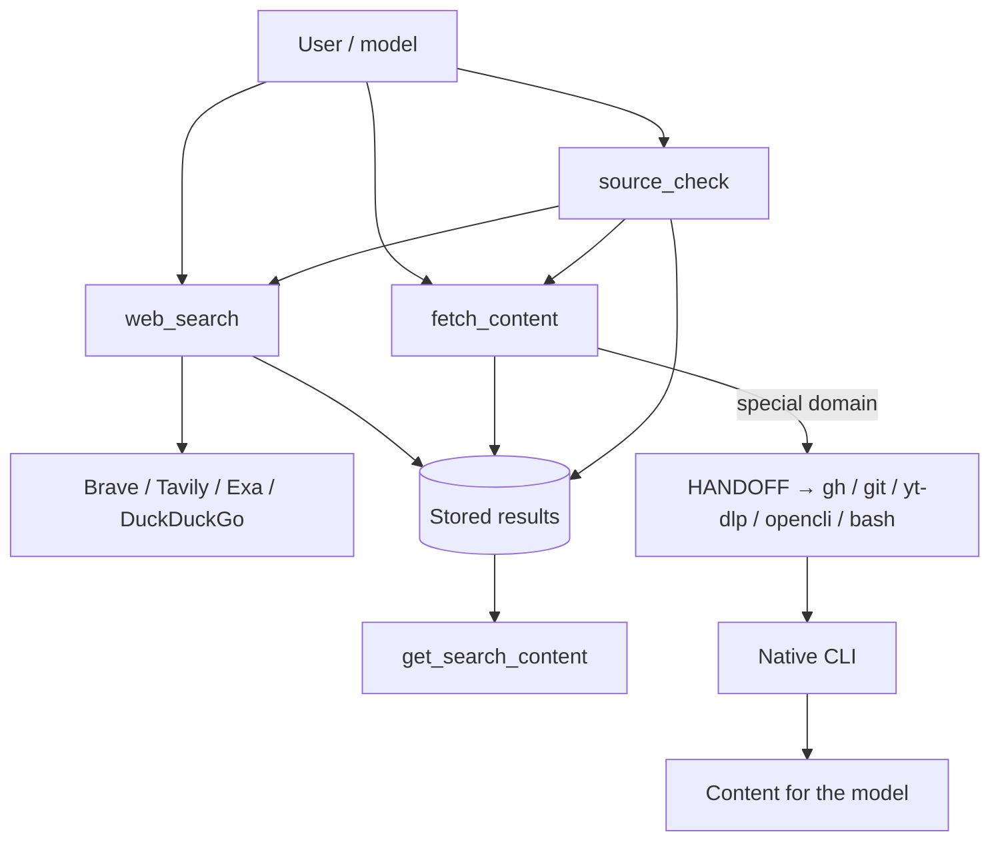

# pi-web

Minimal web access for Pi: search, fetch pages, page stored content, and check claims.

## Install

```bash
pi install git:github.com/S1M0N38/pi-web
```

## Remove

```bash
pi remove git:github.com/S1M0N38/pi-web
```

```bash
rm "${PI_CODING_AGENT_DIR:-$HOME/.pi/agent}/web.json"
```

## Configuration

Create `$PI_CODING_AGENT_DIR/web.json` (default: `~/.pi/agent/web.json`):

```json
{
  "providers": ["brave", "tavily", "exa", "duckduckgo"],
  "braveApiKey": "$BRAVE_API_KEY",
  "tavilyApiKey": "$TAVILY_API_KEY",
  "exaApiKey": "$EXA_API_KEY",
  "answerModel": "provider/model"
}
```

```bash
chmod 600 "${PI_CODING_AGENT_DIR:-$HOME/.pi/agent}/web.json"
```

- `providers` is ordered fallback. Only rate limits fall through to the next provider.
- API keys can be literal strings or `$ENV_VAR` templates. Only keys for listed providers are required.
- `answerModel` is a Pi model reference and uses Pi's existing model authentication.
- All four providers — Brave, Tavily, Exa, and DuckDuckGo — offer free usage/credits. DuckDuckGo needs no API key.
- Missing or invalid config fails at extension load.

## Optional CLIs

These are only needed when a handoff targets them:

- [`gh`](https://github.com/cli/cli) and [`git`](https://github.com/git/git) — GitHub repositories and Gists
- [`yt-dlp`](https://github.com/yt-dlp/yt-dlp) — YouTube
- [`opencli`](https://github.com/jackwener/OpenCLI) — login-gated sites such as Reddit, X, and others
- `curl` — Gist raw fallback
- built-in `bash` / `read` — local files

## How it works

`pi-web` exposes exactly four tools:

- **`web_search`** — searches with the configured providers and stores ranked results.
- **`fetch_content`** — fetches a URL as readable text, raw content, PDF text, or an answer.
- **`get_search_content`** — pages the stored result of a previous search or fetch by `responseId`.
- **`source_check`** — searches and fetches evidence for a claim, then returns sources and passages. It does not declare a claim true or false.



Searches and fetches are stored locally and retrieved through `get_search_content`. For special domains, `fetch_content` does not clone or download anything itself: it returns a `HANDOFF → <tool>` result with commands to run. A handoff is a normal result, not an error. Real failures return `ERROR: <url>`.
